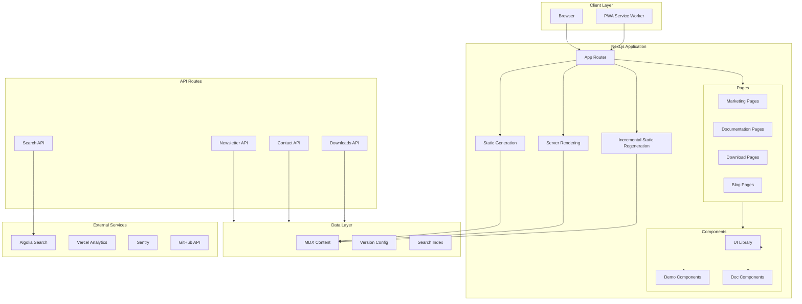
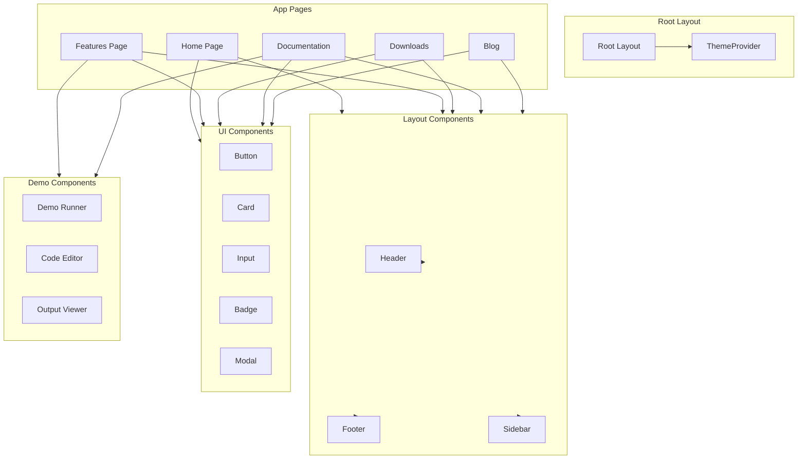
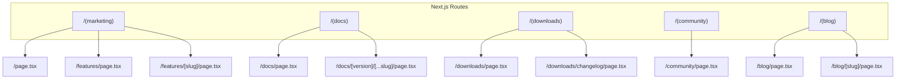

# Fortran² Official Website - Site Architecture Plan

> **Document Version:** 1.0  
> **Status:** Architecture Specification  
> **Last Updated:** 2026-03-13

---

## Table of Contents

1. [Executive Summary](#executive-summary)
2. [Tech Stack Selection](#tech-stack-selection)
3. [Folder Structure](#folder-structure)
4. [Page Hierarchy](#page-hierarchy)
5. [Component Architecture](#component-architecture)
6. [API Structure](#api-structure)
7. [Data Management](#data-management)
8. [Implementation Roadmap](#implementation-roadmap)
9. [Architecture Diagrams](#architecture-diagrams)

---

## Executive Summary

This architecture document defines the complete technical foundation for the Fortran² official website—a high-performance, developer-focused platform showcasing a cutting-edge multi-paradigm programming language. The architecture prioritizes:

- **Performance**: Sub-100ms initial page loads with static generation and edge caching
- **Developer Experience**: Type-safe codebase with comprehensive testing and documentation
- **Scalability**: Modular component system supporting incremental feature additions
- **Accessibility**: WCAG 2.1 AA compliance with semantic HTML and ARIA support

---

## Tech Stack Selection

### Core Framework

| Technology | Version | Purpose |
|------------|---------|---------|
| **Next.js** | 14.2+ | React framework with App Router, SSR/SSG capabilities |
| **TypeScript** | 5.3+ | Type safety across entire codebase |
| **React** | 18.2+ | UI component library |
| **Node.js** | 20 LTS | Runtime for API routes and build tooling |

### Styling & UI

| Technology | Version | Purpose |
|------------|---------|---------|
| **Tailwind CSS** | 3.4+ | Utility-first CSS framework |
| **Framer Motion** | 11+ | Complex animations and transitions |
| **Radix UI** | 1.2+ | Accessible primitives for custom components |
| **Shadcn/ui** | Latest | Component library built on Radix + Tailwind |

### Documentation & Content

| Technology | Version | Purpose |
|------------|---------|---------|
| **MDX** | 3.x | Markdown with React components for docs |
| **next-mdx-remote** | 5.x | Remote MDX content loading |
| **rehype/remark** | 14.x | Markdown processing pipeline |
| **Gray-matter** | 4.x | Frontmatter parsing for docs metadata |

### Developer Tools

| Technology | Version | Purpose |
|------------|---------|---------|
| **ESLint** | 8.x | Code linting and style enforcement |
| **Prettier** | 3.x | Code formatting |
| **Jest** | 29.x | Unit and integration testing |
| **Playwright** | 1.42+ | E2E testing and visual regression |

### Infrastructure & Monitoring

| Technology | Purpose |
|------------|---------|
| **Vercel** | Deployment platform with edge functions |
| **Vercel Analytics** | Performance and visitor analytics |
| **Sentry** | Error monitoring and APM |
| **Algolia** | Search infrastructure |

### Syntax Highlighting

| Technology | Purpose |
|------------|---------|
| **Shiki** | VSCode-compatible syntax highlighting |
| **Prism.js** | Fallback highlighting solution |

---

## Folder Structure

```
f2-website/
├── .github/
│   └── workflows/           # CI/CD pipelines
│       ├── ci.yml
│       ├── deploy.yml
│       └── codeql.yml
├── .vscode/                 # Editor configuration
├── public/
│   ├── assets/
│   │   ├── images/         # Static images and logos
│   │   ├── icons/          # Favicons and UI icons
│   │   └── demos/          # Demo assets and examples
│   ├── fonts/              # Custom font files
│   └── downloads/          # Binary releases (nightly, stable)
├── src/
│   ├── app/                # Next.js App Router (v14+)
│   │   ├── (marketing)/    # Marketing page routes
│   │   │   ├── page.tsx    # Home/Landing
│   │   │   ├── features/
│   │   │   ├── pricing/
│   │   │   └── about/
│   │   ├── (docs)/         # Documentation routes
│   │   │   ├── [[...slug]]/
│   │   │   └── layout.tsx
│   │   ├── (downloads)/    # Download routes
│   │   ├── (community)/    # Community pages
│   │   ├── (blog)/         # Blog routes
│   │   ├── api/            # API routes
│   │   ├── layout.tsx      # Root layout
│   │   └── globals.css     # Global styles
│   ├── components/
│   │   ├── ui/             # Base UI components (atomic)
│   │   │   ├── button.tsx
│   │   │   ├── input.tsx
│   │   │   ├── card.tsx
│   │   │   ├── badge.tsx
│   │   │   ├── dropdown.tsx
│   │   │   └── ...
│   │   ├── layout/         # Layout components
│   │   │   ├── header.tsx
│   │   │   ├── footer.tsx
│   │   │   ├── sidebar.tsx
│   │   │   └── mobile-nav.tsx
│   │   ├── docs/           # Documentation-specific
│   │   │   ├── doc-header.tsx
│   │   │   ├── doc-sidebar.tsx
│   │   │   ├── code-block.tsx
│   │   │   ├── version-selector.tsx
│   │   │   └── table-of-contents.tsx
│   │   ├── demos/          # Interactive demo components
│   │   │   ├── arithmetic-demo.tsx
│   │   │   ├── symbolic-demo.tsx
│   │   │   ├── probabilistic-demo.tsx
│   │   │   ├── differentiable-demo.tsx
│   │   │   └── demo-runner.tsx
│   │   ├── blog/           # Blog components
│   │   ├── search/         # Search functionality
│   │   └── providers/      # React context providers
│   ├── lib/
│   │   ├── utils/          # Utility functions
│   │   │   ├── cn.ts       # Class name merger
│   │   │   └── formatters.ts
│   │   ├── mdx/            # MDX processing utilities
│   │   ├── search/         # Search index and queries
│   │   └── analytics/      # Analytics utilities
│   ├── hooks/              # Custom React hooks
│   ├── types/              # TypeScript type definitions
│   ├── styles/             # Additional style files
│   └── content/            # Static content (MDX files)
│       ├── docs/           # Documentation content
│       │   ├── v1.0/       # Versioned docs
│       │   ├── v0.9/
│       │   └── v0.8/
│       ├── blog/           # Blog posts
│       └── tutorials/      # Tutorial content
├── scripts/                # Build and utility scripts
├── tests/                  # Test configurations
├── .eslintrc.json
├── .prettierrc
├── next.config.js
├── tailwind.config.ts
├── tsconfig.json
└── package.json
```

### Route Grouping Strategy

```typescript
// App Router route groups:
// (marketing)  - Public marketing pages with full SEO
// (docs)      - Documentation with sidebar navigation
// (downloads) - Version downloads and changelogs
// (community) - Community resources and links
// (blog)      - Blog with date-based routing
```

---

## Page Hierarchy

### Marketing Section `(marketing)`

| Path | Component | Description |
|------|-----------|-------------|
| `/` | [`HomePage`](src/app/(marketing)/page.tsx) | Landing page with hero, features overview, CTA |
| `/features` | [`FeaturesPage`](src/app/(marketing)/features/page.tsx) | Detailed feature showcase |
| `/features/advanced-arithmetic` | FeatureDetail | Advanced arithmetic systems |
| `/features/differentiable-programming` | FeatureDetail | Differentiable programming |
| `/features/symbolic-computation` | FeatureDetail | Symbolic computation |
| `/features/probabilistic-programming` | FeatureDetail | Probabilistic programming |
| `/features/metaprogramming` | FeatureDetail | Metaprogramming capabilities |
| `/features/functional-programming` | FeatureDetail | Functional programming |
| `/showcase` | ShowcasePage | User projects and testimonials |
| `/pricing` | PricingPage | Pricing tiers (if applicable) |

### Documentation Section `(docs)`

| Path | Component | Description |
|------|-----------|-------------|
| `/docs` | DocIndex | Documentation home |
| `/docs/[version]/[...slug]` | [`DocPage`](src/app/(docs)/[[...slug]]/page.tsx) | Versioned doc pages |
| `/docs/api` | APIReference | API documentation |
| `/docs/examples` | ExamplesGallery | Code examples gallery |

### Downloads Section `(downloads)`

| Path | Component | Description |
|------|-----------|-------------|
| `/downloads` | [`DownloadsPage`](src/app/(downloads)/page.tsx) | Download latest version |
| `/downloads/nightly` | NightlyDownloads | Nightly builds |
| `/downloads/archive` | ArchiveDownloads | Historical versions |
| `/downloads/changelog` | ChangelogPage | Version changelog |

### Community Section `(community)`

| Path | Component | Description |
|------|-----------|-------------|
| `/community` | CommunityPage | Community hub |
| `/community/discord` | DiscordPage | Discord invite |
| `/community/github` | GitHubPage | GitHub organization |
| `/community/forum` | ForumPage | Community forums link |
| `/contribute` | ContributePage | Contribution guide |

### Blog Section `(blog)`

| Path | Component | Description |
|------|-----------|-------------|
| `/blog` | [`BlogIndex`](src/app/(blog)/page.tsx) | Blog listing |
| `/blog/[slug]` | [`BlogPost`](src/app/(blog)/[slug]/page.tsx) | Individual post |
| `/blog/tags/[tag]` | TaggedPosts | Posts by tag |

### Utility Pages

| Path | Component | Description |
|------|-----------|-------------|
| `/search` | SearchPage | Full-site search |
| `/contact` | ContactPage | Contact form |
| `/privacy` | PrivacyPolicy | Privacy policy |
| `/terms` | TermsOfService | Terms of service |

---

## Component Architecture

### Design System Hierarchy

```
┌─────────────────────────────────────────────────────────┐
│                     Design System                       │
├─────────────────────────────────────────────────────────┤
│  ┌─────────────┐  ┌─────────────┐  ┌─────────────────┐ │
│  │   Tokens    │  │  Primitives │  │    Components   │ │
│  │  (colors,   │──│   (button,  │──│   (cards,       │ │
│  │  spacing,   │  │   input,    │  │    navigation)  │ │
│  │  typography)│  │   badge)    │  │                 │ │
│  └─────────────┘  └─────────────┘  └─────────────────┘ │
│         │               │                 │             │
│         └───────────────┴─────────────────┘             │
│                         │                               │
│              ┌──────────┴──────────┐                   │
│              │     Composed Views    │                  │
│              │  (pages, dashboards)  │                  │
│              └───────────────────────┘                  │
└─────────────────────────────────────────────────────────┘
```

### Core UI Components (`src/components/ui/`)

| Component | Description | Props |
|-----------|-------------|-------|
| [`Button`](src/components/ui/button.tsx) | Primary action button | `variant`, `size`, `loading`, `disabled` |
| [`Input`](src/components/ui/input.tsx) | Form input field | `type`, `placeholder`, `error`, `disabled` |
| [`Select`](src/components/ui/select.tsx) | Dropdown select | `options`, `value`, `onChange` |
| [`Card`](src/components/ui/card.tsx) | Content container | `variant`, `padding`, `hover` |
| [`Badge`](src/components/ui/badge.tsx) | Status/category tag | `variant`, `size` |
| [`Avatar`](src/components/ui/avatar.tsx) | User/profile image | `src`, `alt`, `size`, `fallback` |
| [`Skeleton`](src/components/ui/skeleton.tsx) | Loading placeholder | `variant`, `animated` |
| [`Toast`](src/components/ui/toast.tsx) | Notification | `variant`, `duration`, `onClose` |
| [`Modal`](src/components/ui/modal.tsx) | Dialog overlay | `open`, `onClose`, `title` |
| [`Tooltip`](src/components/ui/tooltip.tsx) | Hover information | `content`, `side`, `delay` |
| [`Tabs`](src/components/ui/tabs.tsx) | Tab navigation | `items`, `defaultValue` |

### Layout Components (`src/components/layout/`)

| Component | Description |
|-----------|-------------|
| [`Header`](src/components/layout/header.tsx) | Main navigation header with logo, nav links, search |
| [`Footer`](src/components/layout/footer.tsx) | Site footer with links, social icons |
| [`Sidebar`](src/components/layout/sidebar.tsx) | Documentation sidebar with tree navigation |
| [`MobileNav`](src/components/layout/mobile-nav.tsx) | Mobile hamburger menu |
| [`Container`](src/components/layout/container.tsx) | Max-width content container |
| [`Grid`](src/components/layout/grid.tsx) | Responsive grid system |

### Documentation Components (`src/components/docs/`)

| Component | Description |
|-----------|-------------|
| [`DocHeader`](src/components/docs/doc-header.tsx) | Page title with breadcrumbs |
| [`DocSidebar`](src/components/docs/doc-sidebar.tsx) | Navigation tree for docs |
| [`CodeBlock`](src/components/docs/code-block.tsx) | Syntax-highlighted code with copy button |
| [`CodeGroup`](src/components/docs/code-group.tsx) | Tabbed code examples |
| [`VersionSelector`](src/components/docs/version-selector.tsx) | Dropdown to switch doc versions |
| [`TableOfContents`](src/components/docs/table-of-contents.tsx) | In-page anchor navigation |
| [`Callout`](src/components/docs/callout.tsx) | Info/warning/danger callouts |
| [`ApiDoc`](src/components/docs/api-doc.tsx) | API reference documentation |

### Demo Components (`src/components/demos/`)

| Component | Description |
|-----------|-------------|
| [`DemoRunner`](src/components/demos/demo-runner.tsx) | Interactive code runner container |
| [`ArithmeticDemo`](src/components/demos/arithmetic-demo.tsx) | Advanced arithmetic demo |
| [`SymbolicDemo`](src/components/demos/symbolic-demo.tsx) | Symbolic computation demo |
| [`ProbabilisticDemo`](src/components/demos/probabilistic-demo.tsx) | Probabilistic programming demo |
| [`DifferentiableDemo`](src/components/demos/differentiable-demo.tsx) | Differentiable programming demo |
| [`DemoOutput`](src/components/demos/demo-output.tsx) | Result display for demos |
| [`DemoEditor`](src/components/demos/demo-editor.tsx) | Code editor for demos |

### Feature Components

| Component | Description |
|-----------|-------------|
| [`FeatureCard`](src/components/features/feature-card.tsx) | Feature showcase card |
| [`FeatureGrid`](src/components/features/feature-grid.tsx) | Grid of feature cards |
| [`HeroSection`](src/components/marketing/hero-section.tsx) | Landing page hero |
| [`TestimonialCarousel`](src/components/marketing/testimonial-carousel.tsx) | User testimonials |
| [`StatsSection`](src/components/marketing/stats-section.tsx) | Statistics/social proof |

### Search Components

| Component | Description |
|-----------|-------------|
| [`SearchModal`](src/components/search/search-modal.tsx) | Command+K search modal |
| [`SearchInput`](src/components/search/search-input.tsx) | Search input field |
| [`SearchResults`](src/components/search/search-results.tsx) | Search results display |

### Provider Components

| Component | Description |
|-----------|-------------|
| [`ThemeProvider`](src/components/providers/theme-provider.tsx) | Dark/light mode context |
| [`DocsVersionProvider`](src/components/providers/docs-version-provider.tsx) | Doc version context |
| [`SearchProvider`](src/components/providers/search-provider.tsx) | Search context |

---

## API Structure

### API Routes Overview

```
/api
├── /search
│   ├── GET /api/search?q={query}     # Full-text search
│   └── GET /api/search/indices       # Rebuild search index
├── /newsletter
│   ├── POST /api/newsletter/subscribe
│   └── POST /api/newsletter/unsubscribe
├── /contact
│   └── POST /api/contact/submit
├── /downloads
│   ├── GET /api/downloads/versions    # List available versions
│   └── GET /api/downloads/latest     # Get latest version info
├── /analytics
│   └── POST /api/analytics/events    # Track custom events
└── /docs
    └── GET /api/docs/versions        # List doc versions
```

### Endpoint Specifications

#### Search API

```typescript
// GET /api/search?q={query}
// Response: { results: SearchResult[], total: number }

interface SearchResult {
  title: string;
  url: string;
  excerpt: string;
  type: 'docs' | 'blog' | 'tutorial';
  version?: string;
  score: number;
}
```

#### Newsletter API

```typescript
// POST /api/newsletter/subscribe
// Body: { email: string }
// Response: { success: boolean, message: string }

interface NewsletterRequest {
  email: string;
  source?: string; // e.g., 'footer', 'download-page'
}

interface NewsletterResponse {
  success: boolean;
  message: string;
  error?: string;
}
```

#### Contact API

```typescript
// POST /api/contact/submit
// Body: { name, email, subject, message, recaptchaToken }
// Response: { success: boolean, ticketId?: string }

interface ContactRequest {
  name: string;
  email: string;
  subject: string;
  message: string;
  recaptchaToken: string;
}
```

#### Downloads API

```typescript
// GET /api/downloads/versions
// Response: { versions: DownloadVersion[], latest: string }

interface DownloadVersion {
  version: string;
  releaseDate: string;
  type: 'stable' | 'beta' | 'nightly';
  downloads: {
    platform: string;
    url: string;
    size: string;
    checksum: string;
  }[];
}
```

---

## Data Management

### Content Strategy

#### Documentation

- **Format**: MDX (Markdown + React components)
- **Location**: `src/content/docs/`
- **Versioning**: Separate directories per version (`v1.0/`, `v0.9/`, etc.)
- **Frontmatter Schema**:
  ```typescript
  interface DocFrontmatter {
    title: string;
    description: string;
    version: string;
    order: number;
    category: 'getting-started' | 'guides' | 'reference' | 'api';
    tags?: string[];
    deprecated?: boolean;
  }
  ```

#### Blog Posts

- **Format**: MDX with syntax highlighting
- **Location**: `src/content/blog/`
- **Frontmatter Schema**:
  ```typescript
  interface BlogFrontmatter {
    title: string;
    description: string;
    author: string;
    date: string;
    tags: string[];
    image?: string;
    draft?: boolean;
  }
  ```

#### Tutorials

- **Format**: MDX with embedded code blocks
- **Location**: `src/content/tutorials/`
- **Structure**: Step-by-step with checkpoints

### Static vs Dynamic Content

| Content Type | Strategy | Reasoning |
|--------------|----------|-----------|
| Home page | SSG + ISR | High traffic, infrequent updates |
| Documentation | SSG + On-demand Revalidation | Content changes with releases |
| Blog posts | SSG | Infrequent updates, high performance |
| Downloads info | SSR | Real-time version data |
| Search results | Client-side + API | Dynamic queries |
| Newsletter signup | Client-side + API | Form submission handling |

### Version Management

```typescript
// Version configuration
const DOCS_VERSIONS = ['v1.0', 'v0.9', 'v0.8'] as const;
const CURRENT_VERSION = 'v1.0';
const MIN_VERSION = 'v0.8';

// Version metadata
interface VersionInfo {
  version: string;
  label: string;
  releaseDate: string;
  isLatest: boolean;
  docsUrl: string;
}
```

---

## Implementation Roadmap

### Phase 1: Foundation (Week 1-2)

1. Initialize Next.js 14 project with TypeScript
2. Configure Tailwind CSS with custom design tokens
3. Set up ESLint and Prettier
4. Create base UI component library
5. Implement layout components (Header, Footer, Container)
6. Configure dark/light theme system

### Phase 2: Core Pages (Week 3-4)

1. Build Home page with hero and features overview
2. Create Features pages with individual feature details
3. Implement Downloads page with version information
4. Build Community hub page
5. Create Blog listing and post pages

### Phase 3: Documentation System (Week 5-6)

1. Set up MDX processing pipeline
2. Create documentation layout with sidebar
3. Implement version selector component
4. Build code block with syntax highlighting
5. Create table of contents
6. Implement doc search functionality

### Phase 4: Interactive Features (Week 7-8)

1. Create demo runner component
2. Implement arithmetic demo
3. Implement symbolic computation demo
4. Implement probabilistic programming demo
5. Implement differentiable programming demo
6. Add demo result visualization

### Phase 5: Backend Services (Week 9-10)

1. Build search API endpoint
2. Implement newsletter subscription API
3. Create contact form API
4. Set up downloads API
5. Configure analytics tracking

### Phase 6: Polish & Testing (Week 11-12)

1. Add animations with Framer Motion
2. Implement responsive design
3. Conduct accessibility audit
4. Add unit and E2E tests
5. Performance optimization
6. Security audit

### Phase 7: Deployment (Week 13)

1. Configure Vercel deployment
2. Set up CI/CD pipelines
3. Configure environment variables
4. Deploy staging environment
5. Production deployment

---

## Architecture Diagrams

### System Architecture



### Component Hierarchy



### Route Structure



---

## Summary

This architecture document provides the complete technical foundation for the Fortran² website. Key architectural decisions:

1. **Next.js 14 App Router** for modern React features and optimal performance
2. **MDX-based content** for flexible documentation and blog posts
3. **Atomic component design** for maintainable UI development
4. **API routes** for serverless backend functionality
5. **Versioned documentation** with flexible switching
6. **Interactive demos** showcasing Fortran² capabilities

The architecture is designed to be immediately implementable by the Code mode with clear component boundaries and well-defined interfaces between layers.

---

*This document serves as the single source of truth for the Fortran² website implementation.*